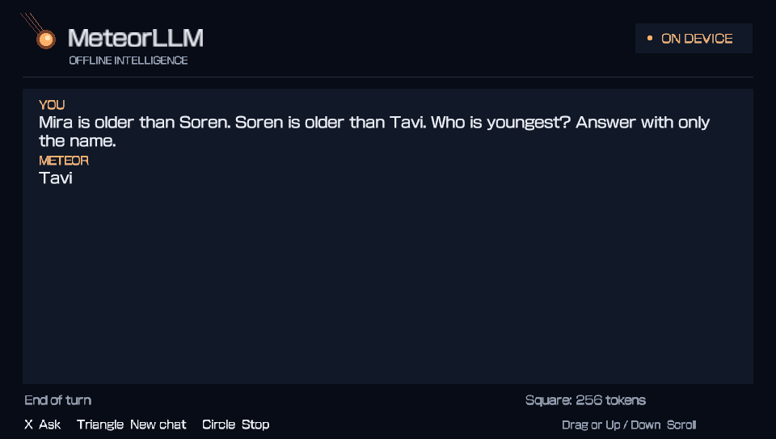
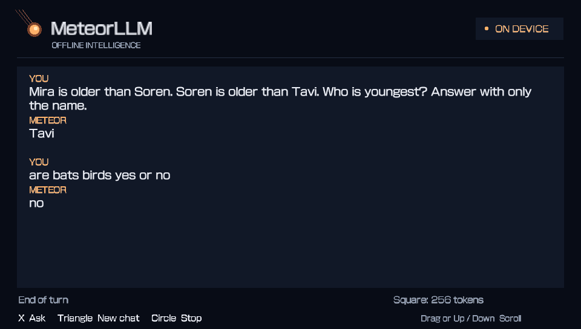

# MeteorLLM

An experimental, completely offline language-model app for PlayStation Vita. **v0.3.0 runs Qwen3.5-0.8B**, replacing v0.2.1's Qwen3-0.6B engine. It runs on the Vita itself; no server or internet connection is used for inference. This is the OverdriveLLM prototype integrated into MeteorLLM's existing chat UI.

[Download v0.3.0](https://github.com/daivarsi/MeteorLLM/releases/tag/v0.3.0)

The updated v0.3.0 VPK includes a device-tested four-core path:
**30.69–30.70 seconds** on short Tavi versus **34.45–34.54 seconds** with three
workers in matched 444 MHz tests. Only the fixed 32-token template was cached;
all answer logits matched exactly. It bundles MIT-licensed CapUnlocker for
runtime loading, with a three-worker fallback and no boot configuration edits.
See [the experiment report](docs/plugin-tests-2026-11-06.md) and
[plugin details](plugins/README.md). Existing 0.8B users only need to reinstall
the updated VPK; the model files are unchanged. The release includes a matching
`MeteorLLM-v0.3.0-four-core-source.zip`; GitHub's automatic v0.3.0 source archives
still describe the original tag.

## Install or update

1. Download and install **MeteorLLM-v0.3.0.vpk**. It updates the existing **METEOR001** title.
2. Download **MeteorLLM-Qwen35-0.8B-model.zip** from the same release.
3. Extract its four model files (`weights.bin`, `embedding.bin`, `output-q4-test.bin`, `tokenizer.bin`) directly into **ux0:data/VitaDesk/MeteorLLM-08/**. Do not leave them inside an extra nested folder.
4. Launch MeteorLLM and wait for model loading and shared-template preparation to finish.

**The new model bundle is required. The old 0.6B files cannot be used with this engine.** Old files in `ux0:data/VitaDesk/MeteorLLM/` are left alone, so v0.2.1 can be reinstalled for rollback. The separate OverdriveLLM app is also left alone. The bundle uses about 611 MiB of storage when extracted; allow additional space for the download and temporary shared-template checkpoint. Model file hashes are in [the manifest](docs/v0.3.0-model-manifest.json), and release assets have SHA256SUMS.txt.

The app does not set CPU clocks. The four-core comparison reported 444 MHz from PSVshellPlus throughout the matched runs. Earlier release measurements did not independently verify their effective clock. PSVshellPlus is not required to launch the app.

## Controls

- **X:** open the keyboard and ask a question.
- **Triangle:** new chat.
- **Circle:** stop prompt processing or generation.
- **Square:** cycle 128 / 256 (default) / 512 / 1024 tokens / Until EOS (4096 maximum).
- **Drag the conversation or hold Up/Down:** scroll the whole chat. At the bottom, new text is followed automatically.

## Actual Vita examples

These are screenshots from the v0.3.0 device run, not rendered mockups.





## Runtime

Same Tavi question and system/chat template, with only the 32 fixed system/template tokens prepared in advance. All 35 remaining prompt tokens are processed normally. No user question or answer is precomputed. Normal conversation state is retained between turns.

| Build | First visible token | Through natural EOS | Answer |
|---|---:|---:|---|
| v0.2.1 Qwen3-0.6B, saved baseline | 28.18 s | 37.14 s | Tavi. |
| Initial Qwen3.5-0.8B UI prototype | 41.74 s | 51.88 s | Tavi |
| **v0.3.0 Qwen3.5-0.8B** | **29.46 s** | **34.32 s** | Tavi |

The new 0.8B run was **33.9% shorter** than the prior 0.8B UI run. It is close to the saved 0.6B runtime on this question, but these are separate single runs, not a controlled clock-matched model comparison. The 0.6B answer also contains an extra punctuation token. This does not establish general throughput or accuracy superiority.

The 34.32 seconds includes 1.54 seconds restoring the shared template, and excludes startup: loading took 24.96 seconds, and preparing/writing the common template took 31.98 seconds. Longer inputs and responses take longer, sometimes much longer when output scoring falls back to the full vocabulary. See [the raw Tavi log](docs/v0.3.0-Tavi.txt) and [the second example](docs/v0.3.0-examples.txt).

## Engine and tradeoffs

The hybrid Qwen3.5 graph uses 18 gated-delta recurrent layers and six full-attention layers. MTP prediction weights are omitted. The build keeps MeteorLLM's int8 activation Q4 kernels, eight-token Cortex-A9 NEON tiles, parallel attention, Q4 output projection, 256-row output reads, 512-token FP16 rolling attention KV and common-template reuse. The updated VPK uses four matrix/attention workers when available, falling back to the original three. Recurrent state remains FP32. It does not implement image inputs.

Reducing the transformer's mixed Q4/Q6 weights to pure Q4 frees about 26.6 MiB. The engine uses that space and a smaller 40 MiB heap to keep **61,440 output-weight rows (33.75 MiB) in RAM**. Those cached rows are unchanged copies of model weights. Host checks show cached and streamed output scoring produce identical full logits. This is a weight cache, not a cache of test prompts or responses.

Output scoring uses a general 65,536-token shortlist plus the special-token tail, with a full-vocabulary scan when the leading scores are close. This remains approximate and may omit better rare or multilingual tokens. To force full-vocabulary scoring, create `output-full.txt` in the new model directory and restart. Create `prefix-cold.txt` to disable shared-template reuse. Both can be substantially slower.

Transformer storage is 268.87 MiB including its header; the combined transformer/output-cache allocation is about 302.62 MiB. The 40 MiB heap includes the 19.27 MiB recurrent state, 6 MiB attention KV, tokenizer and scratch. The tested UI, keyboard, Tavi and bat follow-up all fit with **5 MiB free user system RAM**. This is measured operation, not an exhaustive long-chat memory stress test.

Quality is experimental: factual, arithmetic, grammar, translation and instruction-following mistakes remain possible. Final pure-Q4 smoke checks covered only Tavi, whales, bats and a short Spanish translation. The whale answer identified mammals correctly but added a less precise explanation. Earlier broader 0.8B tests used a different mixed Q4/Q6 model, so their scores should not be attributed to this final build. Quantization and output shortlisting can change answers. Full transcripts are in [the smoke-test file](docs/v0.3.0-host-smoke.jsonl).

The attention ring retains 512 tokens; recurrent state can retain effects from earlier tokens. Eviction is not equivalent to rebuilding a fresh 512-token prompt. After cancellation, the app can replay recent token IDs to recover. The UI retains up to 128 completed turns / 128 KiB of completed text, plus the current turn. A shared-template checkpoint is regenerated each launch on disk to avoid duplicating the recurrent state in RAM.

## Build and reproduce

Requires VitaSDK and libvita2d. Set VITASDK and build:

```sh
cmake -S . -B build -DCMAKE_BUILD_TYPE=Release
cmake --build build
```

Host validation tools:

```sh
cmake -S host -B build-host -DCMAKE_BUILD_TYPE=Release
cmake --build build-host
cd build-host
ctest --output-on-failure
```

`engine-check MODEL_DIRECTORY` checks batch/single-token parity, shared-prefix restoration, exact cached/streamed output equivalence and cancellation. `host-runner MODEL_DIRECTORY CASES.tsv OUTPUT.jsonl` runs greedy short cases; TSV fields are case ID, token limit and prompt. The app uses temperature .7 / top-p .8 / top-20 / seed 1234, so its sampled answers can differ from greedy host tests.

The model was requantized from `ggml-org/Qwen3.5-0.8B-GGUF` revision `807dfd9a6fadbf703207aac3bfb0b2b3040d077c`, Q8_0 SHA-256 `37ae482d336108d23516fa35e8e0c4126688d81018b87178a18d752a1357814f`, using llama.cpp **b12078 / 19e8a86fe**:

```sh
llama-quantize --allow-requantize --pure --token-embedding-type q6_k Qwen3.5-0.8B-Q8_0.gguf Qwen3.5-0.8B-Q4_K-pure.gguf Q4_K_S 3
python export_model.py Qwen3.5-0.8B-Q4_K-pure.gguf model
python export_tokenizer.py
build-host/repack-output model/embedding.bin model/output-q4-test.bin
```

The tested pure-Q4 GGUF SHA-256 is `ed0b4a79b68560b60c671530bd46af487607e8f525b5c759f0557ea355a242a1`. Exported resident weights, embeddings and tokenizer were regenerated and matched the bundled bytes. See [provenance](docs/v0.3.0-provenance.json) and [engine checks](docs/v0.3.0-engine-check.txt).

## Third-party notices

The ggml-derived quantization kernels and reference graph use the pinned llama.cpp source; model weights are Apache-2.0. CapUnlocker is MIT-licensed, copyright GrapheneCt. Exact upstream notices are retained under [licenses](licenses/).
